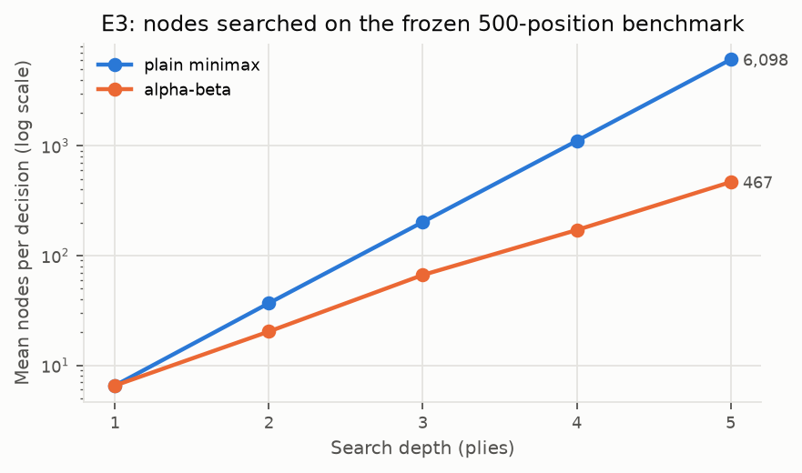
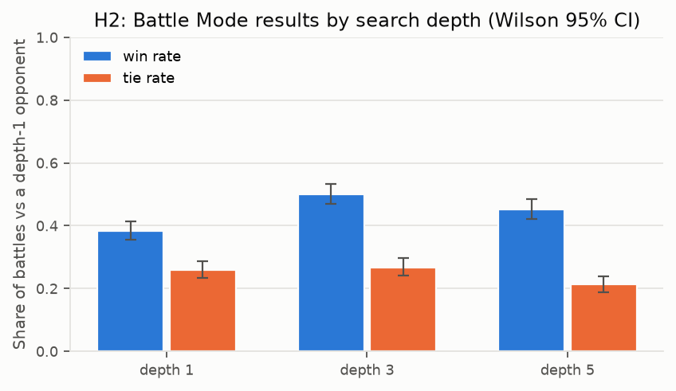
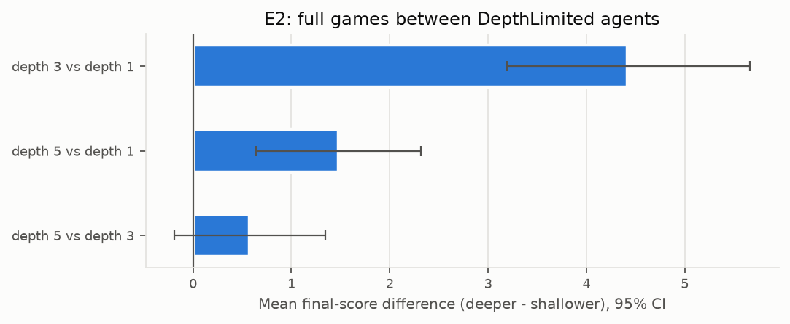
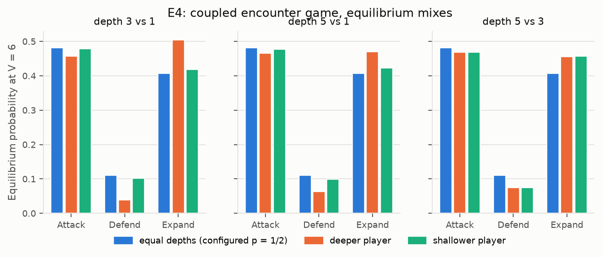
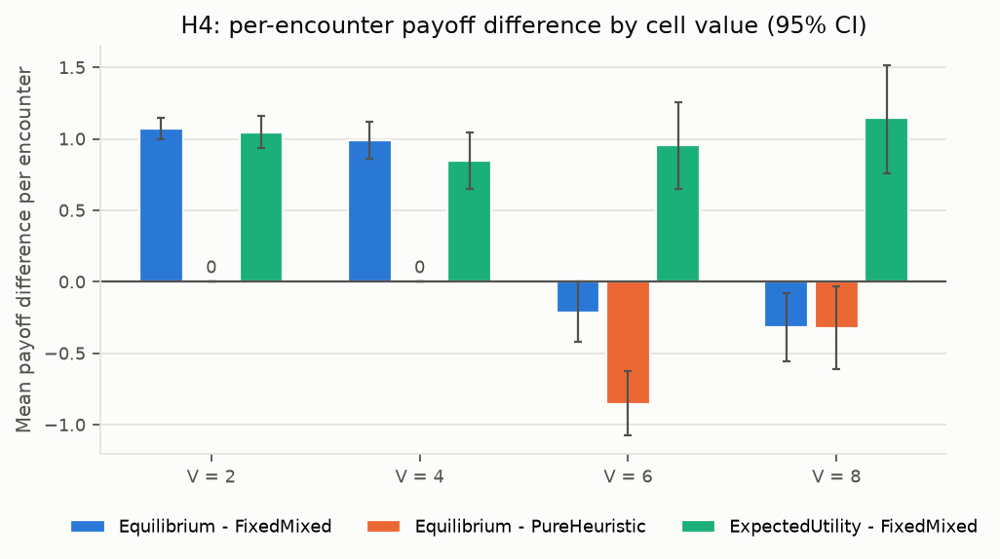
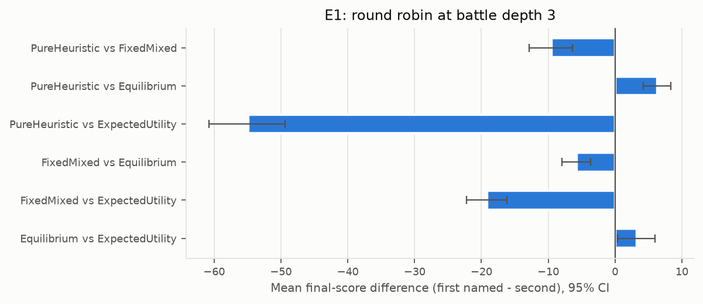
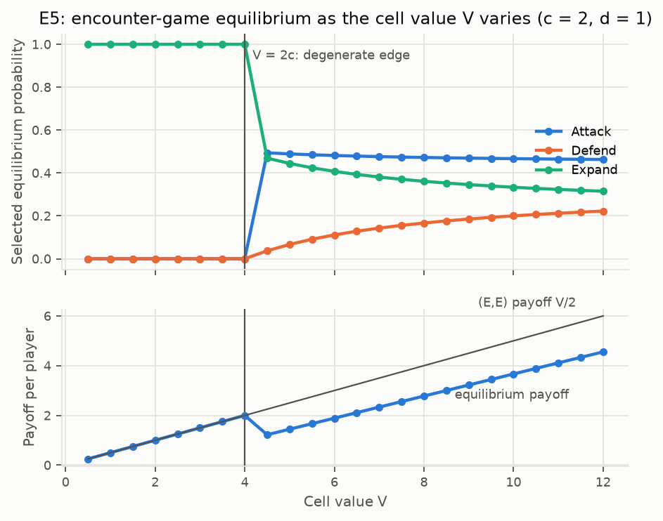

<!-- GENERATED by `python -m resource_war.reproduce` from report/template.md. Do not edit this file; edit the template. -->

# Strategic Agents in a Territory-Conquest Game

**Team Agent9 · CS F407 Artificial Intelligence · Topic: Agents & Game Theory · Track: Demo**
Repository: https://github.com/AI-Projects-S1-26-27/T1_Agent9 · Results commit: `no-commit-yet` (Python 3.13.3, numpy 2.4.6, nashpy 0.0.43)

> **Draft for team review.** Every number in this report comes from code in the repository and is
> regenerated by `python -m resource_war.reproduce`. Section editors: see `docs/ROLES.md`.

---

## 1. Introduction

Agents that compete for scarce resources face two kinds of decision in the same setting.

- **Simultaneous decisions.** When two units reach a contested resource cell, each player commits
  to Attack, Defend or Expand without seeing the other's choice. There is no game tree, so this
  calls for normal-form game theory: dominance, Nash equilibrium and Pareto optimality.
- **Sequential decisions.** When both players attack, a short alternating-move battle follows,
  which is a classic adversarial search problem (minimax, alpha-beta).

We built a working system containing both layers and use it to demonstrate, live, how the
techniques behave. The demo answers four questions:

1. Do agents that compute equilibrium strategies outperform fixed heuristics? (H4)
2. How much does bounded rationality, meaning limited lookahead, cost an agent? (H2)
3. How much does alpha-beta pruning save without changing outcomes? (H1)
4. How does an advantage in sequential lookahead propagate into the simultaneous game? (H3)

**The gap.** Standard tools treat the two layers separately. Normal-form solvers such as nashpy [4]
analyse matrix games, and frameworks such as OpenSpiel [8] run search-based agents. In our
environment the layers are **coupled**: the Attack-vs-Attack payoff is not a constant but is computed
from the *measured* win probability of Battle Mode at the two agents' search depths. We did not find
a teaching/demo environment that exposes this coupling for live inspection *(TODO: the team is
verifying this statement against the literature)*. We do not claim to be the first to study it.

All predictions were written down and committed before any experiment ran (`docs/PREDICTIONS.md`).
Section 5 reports every outcome, including the ones that failed.

## 2. Background and related work

- **Normal-form games.** A Nash equilibrium is a strategy profile from which no player gains by
  deviating alone; every finite game has one in mixed strategies [1]. Shoham and Leyton-Brown [2]
  treat dominance, iterated elimination and Pareto optimality.
- **Computing equilibria.** Support enumeration guesses the supports and solves the indifference
  conditions [3]. nashpy [4] implements it together with vertex enumeration and Lemke–Howson.
- **Adversarial search.** Knuth and Moore [5] analyse alpha-beta pruning, including its best case
  b^⌈d/2⌉ + b^⌊d/2⌋ − 1 leaves. Russell and Norvig [6] give the course treatment of minimax and
  evaluation functions.
- **Bounded rationality.** Simon [7] argued that real decision makers satisfice under computational
  limits. Our depth-limited agents are a concrete, measurable instance.
- **Larger systems.** OpenSpiel [8] collects game environments and algorithms, and AlphaStar [9]
  reached top-level play in a real-time strategy game. Our environment is far smaller, but small
  enough to analyse *exactly*, which is what makes the coupling inspectable.

## 3. Method

### 3.1 Environment

- **Board.** An 8×8 grid with two bases, (0,0) and (7,7), and 3 units each.
  - 12 resource cells come in 6 point-symmetric pairs; each pair shares a value drawn from
    {2, 4, 6, 8}.
  - A used-up cell regrows its value after 8 turns.
  - Games last 40 turns, and score = resources collected + cells owned.
- **Seeded randomness.** One numpy Generator drives all randomness. The same seed and config give a
  byte-identical game log, which a test checks.
- **Experimental control.** Outside encounters, every agent uses the *same* deterministic movement
  and collection policy. Agents differ only in how they play encounters and in their Battle Mode
  depth, so outcome differences come from the decision technique alone. A test checks that with
  identical encounter play the whole game is an exact mirror image.

**Why regrowth (a change from the proposal).** Before building any agent, we measured how often
encounters occur.

- Without regrowth, the 8 map/policy variants averaged only
  1.29–2.73
  encounters per game, and in the worst variant 50%
  of games had none. Agents would mostly tie.
- With regrowth after 8 turns, band placement and value-based targeting, there are
  19.1 encounters per game, and
  100% of games have at least one.

| Placement | Targeting | Tie-break | Regrow after | Encounters / game | Share of games with >= 1 | Mean V at encounter |
|---|---|---|---|---|---|---|
| point_symmetric | nearest | player_relative | none | 1.29 | 0.49 | 4.98 |
| point_symmetric | nearest | player_relative | 8 | 14.02 | 0.96 | 5.09 |
| point_symmetric | nearest | absolute | none | 1.31 | 0.65 | 5.08 |
| point_symmetric | nearest | absolute | 8 | 19.08 | 1.00 | 5.10 |
| point_symmetric | value_per_distance | player_relative | none | 1.46 | 0.54 | 4.58 |
| point_symmetric | value_per_distance | player_relative | 8 | 14.80 | 0.96 | 5.68 |
| point_symmetric | value_per_distance | absolute | none | 1.54 | 0.64 | 4.46 |
| point_symmetric | value_per_distance | absolute | 8 | 15.81 | 1.00 | 5.57 |
| band | nearest | player_relative | none | 1.68 | 0.60 | 4.94 |
| band | nearest | player_relative | 8 | 14.43 | 0.97 | 5.06 |
| band | nearest | absolute | none | 2.15 | 0.86 | 5.06 |
| band | nearest | absolute | 8 | 25.11 | 1.00 | 5.11 |
| band | value_per_distance | player_relative | none | 2.44 | 0.73 | 4.45 |
| band | value_per_distance | player_relative | 8 | 19.15 | 1.00 | 5.45 |
| band | value_per_distance | absolute | none | 2.73 | 0.86 | 4.29 |
| band | value_per_distance | absolute | 8 | 21.61 | 1.00 | 5.37 |

### 3.2 Encounter game (simultaneous layer)

A resource cell occupied by both players triggers an encounter, and each player chooses **A**ttack,
**D**efend or **E**xpand. With cell value V, attack cost c = 2, defend cost d = 1, and battle-win
probabilities p_row and p_col, the row player's payoffs are:

|   | A | D | E |
|---|---|---|---|
| **A** | p_row·V − c | −c | V − c |
| **D** | V − d | −d | −d |
| **E** | 0 | V | V/2 |

The column player's payoffs mirror these, using p_col. Battles can end in a tie, so p_col is
measured separately rather than taken as 1 − p_row.

**The engine pays exactly these entries.** At runtime the engine asserts that the score change of
every non-battle encounter equals its matrix entry. This is what makes the game-theoretic analysis
predictive of the tournament.

**Structure, derived exactly.** At p = ½, E strictly dominates A iff V < 2c.

- **V < 2c:** iterated strict elimination leaves (E,E), "peaceful expansion".
- **V = 2c:** a degenerate edge. A is only weakly dominated, and the equilibria form a continuum.
- **V > 2c:** a cyclic, rock-paper-scissors game. Its unique fully mixed equilibrium is
  Pareto-dominated by (E,E). At V = 6 the equilibrium is (13/27, 3/27, 11/27) with value 51/27,
  against 3 each at (E,E).

### 3.3 Exact equilibrium computation and independent checks

- **Pure-strategy analysis.** Dominance (strict, weak, iterated, and by mixtures), pure equilibria
  and Pareto sets are computed in exact `Fraction` arithmetic.
- **Mixed equilibria.** These come from our own exact support enumeration.
- **Degenerate games.** We detect them exactly: some vertex of a best-response polytope has more
  labels than its dimension *(TODO: citation needed for this characterisation)*. These games are
  solved by exact vertex enumeration.
- **Independent best-response verifier.** It shares no code with the solvers and re-checks every
  equilibrium.
- **Cross-check against nashpy [4].** We compare on every matrix the project uses: 127 matrices,
  including the full sensitivity grid. Property tests on random games found three real problems:
  - nashpy's `support_enumeration` silently drops true equilibria because of float rounding
    (a default `tol=1e-16`, and a hard-coded `prob >= 0` check that rejects −5.6×10⁻¹⁷);
  - our first degeneracy test missed equilibria with unequal supports.
  All three are fixed or worked around, with regression tests.

### 3.4 Battle Mode (sequential layer)

- **Battle.** Each side has 2 units with 2–3 HP on a two-rank (Front/Back) mini-board, and the
  battle is capped at 10 plies. On its ply a side moves one unit: STRIKE (Front against Front,
  1 damage, blocked by DEFEND), DEFEND, RETREAT or ADVANCE.
- **Scoring.**
  - Terminal states score ±1000 plus the HP difference.
  - Depth cut-offs use the evaluation 10·(HP difference) + 2·(Front-unit difference).
- **Searches.** Plain minimax and alpha-beta share the move ordering, and the root keeps the
  *first* maximum. Under these conditions alpha-beta returns the same move as minimax, not just
  the same value; `src/resource_war/battle/alphabeta.py` gives the argument.

### 3.5 Agents

| Agent | Encounter policy |
|---|---|
| PureHeuristic | Attack iff V > 5, else Expand |
| FixedMixed | (A, D, E) = (0.40, 0.35, 0.25) regardless of V |
| Equilibrium | its Nash strategy for the current matrix; ties: highest own payoff, then lexicographic |
| ExpectedUtility | best response to the opponent's empirical frequencies, per V, Dirichlet(1,1,1) prior (fictitious play) |
| DepthLimited(d) | Equilibrium policy with Battle Mode depth d ∈ {1, 3, 5} |

### 3.6 Evaluation protocol

- **Common random numbers.** Each seed is played twice with sides swapped, so both games share the
  same map.
- **Win rates** use Wilson 95% intervals, with ties always reported separately.
- **Mean differences** use a percentile bootstrap that resamples whole clusters: a seed's two
  games, a battle start's two first-mover orders, or one game's encounters.
  *(TODO: citations needed for the Wilson interval and the bootstrap.)*
- **Decision rule.** "X beats Y" iff the 95% CI of the difference excludes 0.
- **Benchmark.** The E3 benchmark is a frozen set of 500 positions that cannot be regenerated.

## 4. Results

### 4.1 Pre-registered predictions at a glance

| Prediction | Pre-registered rule | Outcome | Evidence |
|---|---|---|---|
| H1a | alpha-beta returns minimax's value AND move on every benchmark position, depths 1-5 | supported | 2500 comparisons |
| H1b | mean node ratio (alpha-beta / minimax) at depth 5 <= 0.5 | supported | ratio 0.128 [0.119, 0.136] |
| Gate | plain minimax at depth 5 <= 2.0 s per decision | passed | max 0.373 s, mean 0.064 s |
| H2 | no significant DECREASE in battle win rate with depth (1 <= 3 <= 5) | refuted | proposal criterion (3 > 1 significant): met |
| H3a | deeper player wins more battles (CI of p_deep - p_shallow > 0) | not supported | 3v1: yes, 5v1: yes, 5v3: no |
| H3b | deeper player: higher value, attacks less, expands more; matches closed form; nashpy agrees | not supported | 3v1: yes, 5v1: yes, 5v3: no |
| H3c | deeper player's realized encounter payoff exceeds the shallower's (CI > 0) | not supported | 3v1: yes, 5v1: no, 5v3: no |
| H4a | at V = 6, 8 the Equilibrium agent earns LESS per encounter than FixedMixed and PureHeuristic | supported | vs FixedMixed V=6: yes, vs FixedMixed V=8: yes, vs PureHeuristic V=6: yes, vs PureHeuristic V=8: yes |
| H4b | at V = 2, 4 Equilibrium ties PureHeuristic exactly and beats FixedMixed | supported | vs PureHeuristic V=2: yes, vs PureHeuristic V=4: yes, vs FixedMixed V=2: yes, vs FixedMixed V=4: yes |
| H4c | ExpectedUtility outscores FixedMixed per encounter at every V | supported | V=2: yes, V=4: yes, V=6: yes, V=8: yes |
| E5 | structure rule (V < 2c pure (E,E); V = 2c degenerate; V > 2c cyclic and Pareto-dominated) holds at every grid point | supported | 0 mismatches over 108 grid points |

### 4.2 H1: alpha-beta is exact and cheaper (E3), and the depth-5 gate

- **Identical results.** Alpha-beta returned the same root value *and* the same move as minimax in
  all 2500 comparisons (500 frozen positions × depths 1–5).
- **Node savings.** At depth 5 it searched 0.128
  of minimax's nodes (95% CI 0.119–0.136),
  well under the pre-registered 0.5.
- **Depth 5 is feasible**, which the proposal had only asserted. Plain minimax at depth 5 averaged
  6,098 nodes and 0.064 s per
  decision (worst case 0.373 s), far inside the 2 s gate and below the
  analytic bound of 37,449 nodes. No shrinking of the battle was needed.

| Depth | Positions | Minimax nodes | Alpha-beta nodes | Node ratio | Nodes saved | Minimax ms | Alpha-beta ms | Same value and move |
|---|---|---|---|---|---|---|---|---|
| 1 | 500 | 7 | 7 | 1.000 | 0.0% | 0.07 | 0.06 | yes |
| 2 | 500 | 37 | 20 | 0.591 | 40.9% | 0.38 | 0.23 | yes |
| 3 | 500 | 202 | 67 | 0.388 | 61.2% | 2.09 | 0.75 | yes |
| 4 | 500 | 1,107 | 171 | 0.220 | 78.0% | 11.60 | 1.95 | yes |
| 5 | 500 | 6,098 | 467 | 0.128 | 87.2% | 64.20 | 5.42 | yes |

| Quantity | Value |
|---|---|
| Full tree nodes, b = 8, depth 5 (analytic upper bound) | 37,449 |
| Knuth-Moore best-case leaves (analytic) | 575 |
| Measured minimax nodes at depth 5: mean / max | 6,098 / 25,269 |
| Measured minimax seconds at depth 5: mean / 95th pct / max | 0.064 / 0.166 / 0.373 |
| Gate (max must be <= this) | 2.0 s: passed |

*Mean nodes per decision on the frozen benchmark (log scale).*

### 4.3 H2: does more lookahead help? (battle level)

Against a fixed depth-1 opponent, each depth played 1000 battles (500 starts × 2 first-mover orders).

- **Depth 3 beats depth 1** by +0.117 in win rate
  (CI +0.094 to +0.141).
- **Depth 5 also beats depth 1**, by +0.069.
- **But depth 5 is significantly *worse* than depth 3:** -0.048
  (CI -0.065 to -0.032).

The pre-registered monotonicity prediction H2 is therefore **refuted**. The proposal's weaker
criterion, that win rate increases with depth "at least up to a point", is met.

| Tested depth (vs depth 1) | Battles | Win rate | Tie rate | Loss rate |
|---|---|---|---|---|
| depth 1 | 1000 | 0.384 [0.354, 0.415] | 0.259 [0.233, 0.287] | 0.357 [0.328, 0.387] |
| depth 3 | 1000 | 0.501 [0.470, 0.532] | 0.268 [0.241, 0.296] | 0.231 [0.206, 0.258] |
| depth 5 | 1000 | 0.453 [0.422, 0.484] | 0.213 [0.189, 0.239] | 0.334 [0.305, 0.364] |

| Paired difference | Estimate [95% CI] |
|---|---|
| w(3) - w(1) | 0.117 [0.094, 0.141] |
| w(5) - w(1) | 0.069 [0.047, 0.091] |
| w(5) - w(3) | -0.048 [-0.065, -0.032] |

Same start and first mover, outcome at depth 3 (rows) vs depth 5 (columns):

|  | depth 5 win | depth 5 tie | depth 5 loss |
|---|---|---|---|
| depth 3 win | 448 | 53 | 0 |
| depth 3 tie | 5 | 148 | 115 |
| depth 3 loss | 0 | 12 | 219 |

*Battle outcomes against a depth-1 opponent, by search depth.*

**Why deeper is not always better (mechanism, found by inspecting individual battles).**

1. Within its horizon, minimax assumes a *perfect* opponent.
2. From ply 5 onwards a depth-5 search reaches the 10-ply cap and can *prove* that a position is a
   draw under perfect play. Every drawing move then scores exactly 0.
3. By the first-maximum rule it plays the first of them, often a STRIKE that exposes a unit.
4. A depth-3 search cannot see the end. It keeps following the heuristic (DEFEND), and the myopic
   depth-1 opponent then wastes its moves on a defended unit, so depth 3 wins.

The same mechanism applies to positions that are *lost* under perfect play: every move then looks
equally bad, and the first one is chosen. The joint table (same start and first mover) shows where
the gap comes from:

- depth 3 draws and depth 5 loses in 115 battles;
- depth 3 wins and depth 5 only draws in 53 battles;
- the reverse cases occur only 12 and 5 times;
- the two depths never split as win vs loss in either direction.

This is a cost of optimising against a perfect opponent when the real opponent is fallible: a
concrete instance of the bounded-rationality question.

### 4.4 Full games at different depths (E2)

In full games, depth 3 outscores depth 1 by 4.41 points
per game, and depth 5 outscores depth 1 by 1.48.
Depth 5 against depth 3 shows no detectable difference
(0.57, CI -0.19
to 1.34).

The effects are small in score terms because battles are rare (2.6 per game in the 3-vs-1 pairing). Most encounter
value is decided in the simultaneous layer.

| Pairing (first vs second) | Games | First win rate | Second win rate | Tie rate | Score diff (first - second) | Verdict |
|---|---|---|---|---|---|---|
| depth 3 vs depth 1 | 400 | 0.545 [0.496, 0.593] | 0.383 [0.336, 0.431] | 0.072 [0.051, 0.102] | 4.41 [3.19, 5.66] | first-named beats second-named |
| depth 5 vs depth 1 | 400 | 0.497 [0.449, 0.546] | 0.435 [0.387, 0.484] | 0.068 [0.047, 0.096] | 1.48 [0.64, 2.32] | first-named beats second-named |
| depth 5 vs depth 3 | 400 | 0.475 [0.427, 0.524] | 0.453 [0.404, 0.501] | 0.072 [0.051, 0.102] | 0.57 [-0.19, 1.34] | no detectable difference |

| Pairing | Mean score (first / second) | Resources collected | Territory held at end | Encounters / game | Battles / game |
|---|---|---|---|---|---|
| depth 3 vs depth 1 | 106.34 / 101.92 | 109.83 / 105.35 | 8.21 / 8.22 | 18.8 | 2.59 |
| depth 5 vs depth 1 | 105.47 / 103.99 | 108.65 / 107.30 | 8.27 / 8.21 | 18.8 | 2.50 |
| depth 5 vs depth 3 | 104.67 / 104.09 | 108.09 / 107.54 | 8.22 / 8.17 | 18.9 | 2.54 |

*Full-game score difference, deeper minus shallower agent.*

### 4.5 H3: coupling the layers (E4)

**Method.** For each depth pair we measured both battle-win probabilities, put them into the
Attack-vs-Attack cell at V = 6, and solved the resulting asymmetric game exactly.

| Depths (deep vs shallow) | Battles | p_deep | p_shallow | Tie rate | Deep mix (A, D, E) | Shallow mix (A, D, E) | Equilibrium value deep / shallow | Realized payoff diff (deep - shallow) |
|---|---|---|---|---|---|---|---|---|
| 3 vs 1 | 1000 | 473/1000 = 0.473 [0.442, 0.504] | 131/500 = 0.262 [0.236, 0.290] | 0.265 | (0.457, 0.039, 0.504) | (0.479, 0.102, 0.419) | 1.872 / 1.744 | 0.198 [0.009, 0.392] |
| 5 vs 1 | 1000 | 463/1000 = 0.463 [0.432, 0.494] | 87/250 = 0.348 [0.319, 0.378] | 0.189 | (0.466, 0.064, 0.470) | (0.478, 0.099, 0.423) | 1.865 / 1.794 | 0.005 [-0.192, 0.203] |
| 5 vs 3 | 1000 | 191/500 = 0.382 [0.352, 0.413] | 48/125 = 0.384 [0.354, 0.415] | 0.234 | (0.469, 0.075, 0.456) | (0.469, 0.074, 0.457) | 1.815 / 1.816 | 0.007 [-0.187, 0.201] |

*Equilibrium mixes at V = 6 in the coupled game.*

**Pre-registered outcomes.**

- **H3a** (the deeper player wins more battles) holds for 3 vs 1 and 5 vs 1, but **not for 5 vs 3**:
  their measured win probabilities are 0.382 and 0.384,
  consistent with the H2 finding.
- **H3b and H3c are therefore "not supported" as pre-registered**: their rules assume the deeper
  player is the stronger battler.
- **H3c is also underpowered for 5 vs 1.** The predicted equilibrium-value gap is only
  0.071 per encounter,
  smaller than 2,000 simulated encounters can resolve (realized gap
  0.005, CI -0.192 to 0.203).
- **For 3 vs 1, where the battle advantage is largest, the realized gap is significant:**
  0.198 (CI 0.009 to 0.392).

**Exploratory (not pre-registered).** Restate H3b with "stronger" meaning the player with the higher
*measured* battle-win probability. The indifference-principle prediction then holds in **all three**
pairs: the stronger battler attacks less, defends less and expands more, while the weaker one
attacks more. The game-theoretic mechanism behaves as derived. What failed is the empirical premise
that more depth always buys battle strength.

### 4.6 H4: equilibrium play does not exploit; opponent modelling does (E1)

| V | Equilibrium vs FixedMixed | Equilibrium vs PureHeuristic | ExpectedUtility vs FixedMixed | ExpectedUtility vs PureHeuristic |
|---|---|---|---|---|
| 2 | 0.954 vs -0.117; diff 1.071 [0.996, 1.146] (n=1342) | 1.000 vs 1.000; diff 0.000 [0.000, 0.000] (n=1300) | 0.931 vs -0.115; diff 1.046 [0.934, 1.159] (n=1308) | 1.000 vs 1.000; diff 0.000 [0.000, 0.000] (n=1328) |
| 4 | 1.921 vs 0.933; diff 0.989 [0.862, 1.118] (n=2139) | 2.000 vs 2.000; diff 0.000 [0.000, 0.000] (n=2096) | 1.751 vs 0.907; diff 0.844 [0.647, 1.043] (n=2172) | 2.000 vs 2.000; diff 0.000 [0.000, 0.000] (n=2136) |
| 6 | 1.530 vs 1.742; diff -0.213 [-0.420, -0.001] (n=1990) | 0.667 vs 1.521; diff -0.854 [-1.077, -0.627] (n=2038) | 2.648 vs 1.692; diff 0.956 [0.650, 1.254] (n=1996) | 3.419 vs -0.103; diff 3.522 [3.176, 3.810] (n=1948) |
| 8 | 2.166 vs 2.482; diff -0.316 [-0.558, -0.079] (n=2361) | 1.767 vs 2.095; diff -0.327 [-0.613, -0.034] (n=2364) | 3.560 vs 2.416; diff 1.145 [0.761, 1.518] (n=2238) | 5.987 vs -0.843; diff 6.830 [6.633, 7.003] (n=2212) |

*Per-encounter payoff differences by cell value, with 95% CIs.*

All three pre-registered encounter-level predictions hold.

- **H4a, the Equilibrium agent at V ∈ {6, 8}.** It earns *less* per encounter than both FixedMixed
  and PureHeuristic. Equilibrium play makes the opponent indifferent, so the opponent earns the
  equilibrium value whatever it does, but it does not punish the opponent's mistakes.
- **H4b, the Equilibrium agent at V ∈ {2, 4}.** It ties PureHeuristic exactly (both expand) and
  beats FixedMixed, which attacks even where attacking is dominated.
- **H4c, ExpectedUtility.** By modelling its opponent, it outscores FixedMixed at every V.

**Full games (H4d, exploratory).**

The ranking is **not transitive**. FixedMixed beats PureHeuristic, Equilibrium beats FixedMixed,
and PureHeuristic beats Equilibrium: a rock-paper-scissors cycle at the level of agents.
ExpectedUtility crushes both fixed agents (for example, it beats PureHeuristic by
-54.9 points per game). Yet it loses to
Equilibrium by 3.26 points: against an
equilibrium player every best response pays the same, and the response it settles on (Expand at
V = 6) hands the Equilibrium agent 82/27 ≈ 3.04 per encounter instead of the equilibrium value
17/9 ≈ 1.89 (both exact, pinned in `tests/test_predictions_analytic.py`).

| Pairing (first vs second) | Games | First win rate | Second win rate | Tie rate | Score diff (first - second) | Verdict |
|---|---|---|---|---|---|---|
| PureHeuristic vs FixedMixed | 400 | 0.375 [0.329, 0.423] | 0.608 [0.559, 0.654] | 0.018 [0.009, 0.036] | -9.49 [-12.82, -6.39] | second-named beats first-named |
| PureHeuristic vs Equilibrium | 400 | 0.580 [0.531, 0.627] | 0.375 [0.329, 0.423] | 0.045 [0.029, 0.070] | 6.29 [4.20, 8.38] | first-named beats second-named |
| PureHeuristic vs ExpectedUtility | 400 | 0.040 [0.025, 0.064] | 0.930 [0.901, 0.951] | 0.030 [0.017, 0.052] | -54.92 [-60.74, -49.35] | second-named beats first-named |
| FixedMixed vs Equilibrium | 400 | 0.378 [0.331, 0.426] | 0.610 [0.561, 0.657] | 0.013 [0.005, 0.029] | -5.79 [-7.95, -3.62] | second-named beats first-named |
| FixedMixed vs ExpectedUtility | 400 | 0.188 [0.152, 0.229] | 0.795 [0.753, 0.832] | 0.018 [0.009, 0.036] | -19.18 [-22.23, -16.20] | second-named beats first-named |
| Equilibrium vs ExpectedUtility | 400 | 0.557 [0.509, 0.605] | 0.383 [0.336, 0.431] | 0.060 [0.041, 0.088] | 3.26 [0.34, 5.95] | first-named beats second-named |

| Pairing | Mean score (first / second) | Resources collected | Territory held at end | Encounters / game | Battles / game |
|---|---|---|---|---|---|
| PureHeuristic vs FixedMixed | 89.53 / 99.02 | 103.35 / 113.35 | 8.26 / 8.26 | 19.5 | 4.46 |
| PureHeuristic vs Equilibrium | 102.43 / 96.14 | 116.19 / 100.02 | 8.25 / 8.25 | 19.5 | 5.21 |
| PureHeuristic vs ExpectedUtility | 76.11 / 131.03 | 88.46 / 130.64 | 8.45 / 8.45 | 19.1 | 0.00 |
| FixedMixed vs Equilibrium | 96.04 / 101.83 | 110.72 / 105.80 | 8.11 / 8.05 | 19.6 | 2.14 |
| FixedMixed vs ExpectedUtility | 94.51 / 113.69 | 108.88 / 108.02 | 8.26 / 8.26 | 19.3 | 0.07 |
| Equilibrium vs ExpectedUtility | 110.40 / 107.14 | 114.22 / 103.52 | 8.34 / 8.34 | 19.3 | 0.35 |

*E1 round robin: mean final-score difference per pairing.*

### 4.7 E5: how the structure changes with the configuration

Over the ±25% grid on V, c and d (108 grid points), the pre-registered
structure rule held with 0 mismatches:

- below 2c, peaceful expansion;
- at 2c, a degenerate continuum;
- above 2c, a cyclic mixed equilibrium that is Pareto-dominated by (E,E).

The defend cost d never changes the regime, only the mixing probabilities.

| Structure | Grid points |
|---|---|
| cyclic, unique fully mixed | 60 |
| degenerate (continuum) | 9 |
| pure (E,E) by iterated strict dominance | 39 |

Degenerate grid points: (V=3, c=1.5, d=0.75), (V=3, c=1.5, d=1), (V=3, c=1.5, d=1.25), (V=4, c=2, d=0.75), (V=4, c=2, d=1), (V=4, c=2, d=1.25), (V=5, c=2.5, d=0.75), (V=5, c=2.5, d=1), (V=5, c=2.5, d=1.25).

Mismatches with the pre-registered rule: 0 of 108.

*Selected equilibrium and its payoff as V varies. Above V = 2c the equilibrium payoff falls below the (E,E) payoff V/2: the Pareto gap.*

## 5. Discussion and limitations

- **What the demo shows.**
  - The same matrix machinery explains outcomes in a full game, because the engine pays exactly
    the matrix entries.
  - Equilibrium play is a safe floor, not a winning strategy (H4).
  - Alpha-beta is a free speed-up (H1).
  - Lookahead is not monotonically valuable against a fallible opponent (H2).
- **Small, hand-designed world.** 8×8 board, two players, 3 units each. The payoffs are hand-designed
  (justified in DESIGN §2, and their structure is shown robust to ±25% changes in E5), not
  estimated from any real system.
- **Battle abstraction.** The battle is deliberately tiny (2 units, 10 plies) so that depth 5 is
  exact and cheap. The depth-5 "proven draw" effect is partly an artefact of the short ply cap.
- **Tie-breaking matters.** Breaking minimax ties by the heuristic evaluation would likely remove
  the H2 effect. We did not change the pre-registered design after seeing the result; this is
  future work.
- **Opponent modelling.** The ExpectedUtility agent is plain fictitious play with a fresh model each
  game. A model that persisted across games, or used smoothed beliefs, would behave differently.
- **Power.** H3c needed far more than 2,000 encounters for the small 5-vs-1 gap; the sample size
  was pre-registered before the effect size was known.
- **Equilibrium selection.** Each Equilibrium agent selects independently, which can mis-coordinate
  in games with several equilibria (the demo shows this on Battle of the Sexes). In our encounter
  matrices both agents select the same equilibrium.

## 6. Changes since the proposal

See `docs/DESIGN.md` §9 and `docs/DECISIONS.md` for the full log. The main changes:

- regrowth, band placement and value-based targeting (from the encounter-frequency gate);
- a separate tie probability in the Attack-vs-Attack cell;
- the two-rank battle board with ADVANCE;
- an `observe()` hook for learning agents;
- the H3 coupling question added;
- a single owner and reviewer per component;
- implementation started late (the repository was empty until 13 Nov 2026); see §10.

## 7. Response to proposal feedback

| Feedback | Response | Evidence |
|---|---|---|
| Problem 4/5: no stated gap | §1 states the gap: the two layers are coupled, measured and inspectable live. H3 tests the coupling. | §4.5, `docs/DESIGN.md` §1 |
| Approach 4/5: payoff numbers deferred | Payoffs locked in `config/payoffs.yaml`, with worked equilibria pinned by exact unit tests | §3.2, `tests/test_known_answers.py` |
| Approach 4/5: depth 5 asserted, not estimated | Analytic estimate (37,449 nodes; Knuth–Moore 575 leaves) plus a measured gate | §4.2, E3 tables |
| Feasibility 2/3: unclear role table | One owner and one reviewer per component, enforced by a test on every module docstring | `docs/ROLES.md`, `tests/test_skeleton.py` |
| First round: show outcomes under different configurations, with measurable differences | Configuration explorer in the demo; E5 sweep; tournaments with CIs | §4.6, §4.7 |

## 8. Individual contributions

*(Each member writes their own entry and confirms it before submission. The component list is in
`docs/ROLES.md`; decisions per component are in `docs/DECISIONS.md`. State honestly what you
personally did, reviewed and can explain.)*

| Member | Component owned | Personal contribution (to be written by the member) |
|---|---|---|
| Rohit Gangil | Integration, repo, CI, live demo UI | TODO |
| Vaibhav Malik | Game engine | TODO |
| Atharv Singhal | Encounter analysis (matrix, dominance, pure Nash, Pareto) | TODO |
| Gursidak Singh Bassi | Mixed Nash, nashpy validation, verifier | TODO |
| Harshit Agrawal | Battle Mode, evaluation, minimax | TODO |
| Raunak Sarawgi | Alpha-beta, instrumentation, E3 | TODO |
| Tushya Jain | Agent library | TODO |
| Manas Tripathi | Tournaments, statistics, plots | TODO |
| Jainam Parekh Naresh | Test suite, robustness, validation | TODO |

## 9. AI usage

We used **Claude Code (Anthropic, Claude Opus 5.5)** extensively: for checking the hand-computed
equilibria, drafting the design documents, and generating most of the code, tests and this report
template. The running log with dates and verification steps is `docs/AI_USAGE.md`.

**How the output was verified.**

- The automated test suite (`pytest`), including:
  - known-answer fixtures written before the solvers;
  - an independent best-response verifier;
  - the nashpy cross-check on 127 matrices;
  - Hypothesis property tests;
  - alpha-beta/minimax equivalence on 2,500 seeded position-depth pairs in the tests, plus
    2500 frozen-benchmark comparisons in E3;
  - minimax against brute-force enumeration;
  - byte-identical replay tests.
- Every number in this report is generated from result files, and guarded checks fail the build if
  the narrative stops matching the data.
- Property tests caught real defects in the AI-generated code (a degeneracy-detection gap) and in a
  third-party library (nashpy rounding).

Each module owner must still review their module, and must be able to explain every line in the
viva (course guidelines §6).

## 10. Reflection

- **Schedule.** The proposal planned 8 weeks from 2 October. The repository stayed empty until
  13 November, and most of the implementation was produced in a short, AI-assisted burst. That
  history is visible in the commit log, and we disclose it here rather than obscure it.
- **What went well.**
  - Pre-registering predictions forced honest reporting: two of our four headline hypotheses
    failed, and the failures taught us the most (H2's "proven draw" effect; H3's premise).
  - Measuring the encounter frequency before building agents caught a design flaw that would have
    made every agent tie.
- **What we would do differently.**
  - Start implementation in week 2 as planned.
  - Commit module by module, with owners writing and reviewing their own code.
  - Run a power analysis before fixing the sample sizes.

## References

[1] J. Nash, "Equilibrium points in n-person games," *PNAS* 36(1), 1950. https://doi.org/10.1073/pnas.36.1.48
[2] Y. Shoham and K. Leyton-Brown, *Multiagent Systems: Algorithmic, Game-Theoretic, and Logical Foundations*, CUP, 2009. https://doi.org/10.1017/CBO9780511811654
[3] R. Porter, E. Nudelman, Y. Shoham, "Simple search methods for finding a Nash equilibrium," *Games and Economic Behavior* 63(2), 642–662, 2008. https://doi.org/10.1016/j.geb.2006.03.015
[4] V. Knight and J. Campbell, "Nashpy: A Python library for the computation of Nash equilibria," *JOSS* 3(30), 904, 2018. https://doi.org/10.21105/joss.00904
[5] D. Knuth and R. Moore, "An analysis of alpha-beta pruning," *Artificial Intelligence* 6(4), 1975. https://doi.org/10.1016/0004-3702(75)90019-3
[6] S. Russell and P. Norvig, *Artificial Intelligence: A Modern Approach*, 4th ed., Pearson, 2020. https://aima.cs.berkeley.edu/
[7] H. Simon, "A behavioral model of rational choice," *Quarterly Journal of Economics* 69(1), 1955. https://doi.org/10.2307/1884852
[8] M. Lanctot et al., "OpenSpiel: A framework for reinforcement learning in games," arXiv:1908.09453, 2019. https://arxiv.org/abs/1908.09453
[9] O. Vinyals et al., "Grandmaster level in StarCraft II using multi-agent reinforcement learning," *Nature* 575, 2019. https://doi.org/10.1038/s41586-019-1724-z
